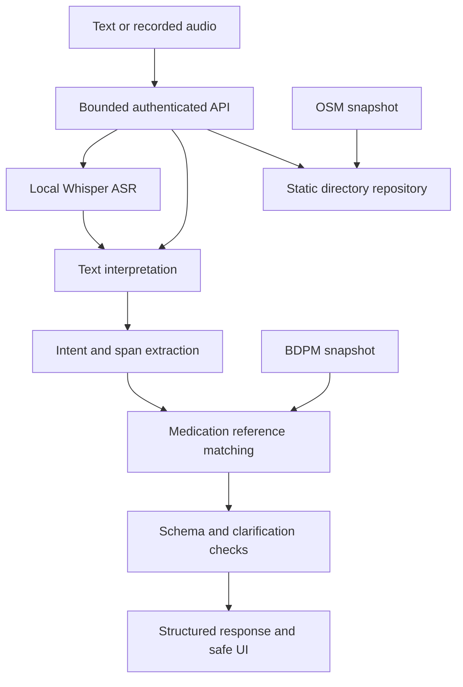

# Architecture and operating limits

The baseline is the default. The optional hybrid uses learned intent scores with
baseline entities and reference matching; learned BIO spans are evaluated
separately, not automatically trusted as dispensable products. The LLM track
accepts only strict v1 JSON through a provider-neutral HTTPS adapter. Schema,
raw-text evidence, reference grounding and baseline clinical-routing checks
remain in control. Failure falls back to the baseline.

Normalizers preserve a Unicode code-point alignment map. Span extraction refers
to the original text/transcript. Arabic digit/mark/alef/ya folding and lexical
Arabizi conversion are separate from numerical strengths. Language detection is
heuristic, with explicit caller hints accepted. Confidence values in the baseline
are fixed routing scores, not calibrated medical probabilities.

The directory is static OSM data; no stock, live duty status or missing phone is
invented. Medication reference data is the attributed France BDPM fallback,
not proof of Moroccan market availability. Optional normalized name/DCI fields
are populated only from an unambiguous reference match.

API keys are optional environment settings. CORS is an explicit allowlist.
Request size and in-memory per-client rate limits are enforced. The limiter is
single-process prototype infrastructure: use a shared gateway/limiter for a
multi-worker deployment. Logs contain IDs, paths, statuses and elapsed time,
not medication text, transcripts, keys or audio. Uploaded audio is temporary.
No cloud ASR/LLM is called unless explicitly configured by the operator.

GET /health means process liveness, not model/data readiness. Models and SQLite
are initialized lazily; the demo startup builds SQLite from committed attributed
snapshots when absent. No upstream scraping or model download happens at import
or inference. Model caching is a separate explicit command.

This is a development prototype. It does not diagnose, select treatment, advise
dosage/substitutions, validate prescriptions, place orders or confirm stock.
Unsafe question clauses are represented by a flag and politely refused in the UI.
Recorded-audio quality and independent clinical-language generalization remain
unvalidated. A synthetic ASR smoke test does not establish Darija accuracy.
